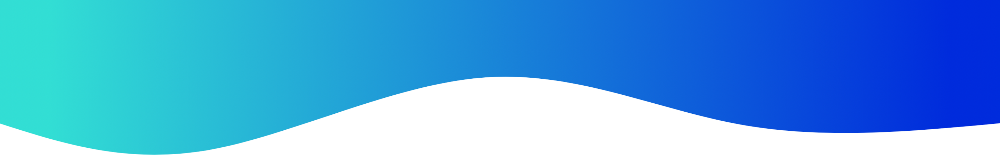
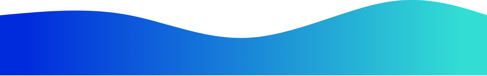

# Mohammed Rizin: Machine Learning Engineer

**Kaggle Competitions Master · Computer Vision · CUDA · Reinforcement Learning · LLM Fine-tuning**

 

---

## About

I'm a machine learning engineer based in Mumbai, India, with four years of production experience in computer vision, medical AI, LLM-backed systems, CUDA and reinforcement learning. I'm a **Kaggle Competitions Master** with 12 medals, ranked in the global top 38, and most of them come from code competitions where the organiser runs your submission against a hidden test set under a fixed compute budget.

I'm currently on contract with Shipd / DataCurve. More about my work, competition record and writing is on my site: **[morizin.github.io](https://morizin.github.io)**.

### What I can help with
- **Evaluation and task design:** coding tasks, verifiers and benchmark sets for training or evaluating agents, packaged to run in Docker.
- **CUDA and GPU performance:** reference kernels, profiling and multi-GPU training speed-ups.
- **Computer vision, prototype to production:** detection and classification systems deployed on server, browser or edge devices.
- **RL and simulation research:** PPO and GRPO from scratch, model-graded rewards, MuJoCo and Gymnasium environments.

---

## Experience

| Where | Role | What I did |
|---|---|---|
| **Shipd / DataCurve** | Contract machine learning engineer (current) | Work I can name but can't describe |
| **Mercor** | Contract machine learning engineer (earlier this year) | Work I can name but can't describe |
| **Medulla** | Founding ML researcher | Built an LLM-backed clinical assistant with a retrieval-and-citation pipeline over a curated medical corpus, and led a team of three through three pivots |
| **Fathom Solutions** | Deep learning engineer | Doubled a road-damage detector's mAP and shipped it to the browser with TensorFlow.js |
| **NVIDIA** | Deep learning intern | Distributed multi-GPU training, Docker and Triton-served inference; wrote conversion scripts that shipped as Deep Learning Institute course material |

---

## Selected projects

| Project | What it is |
|---|---|
| [**Jigsaw: Agile Community Rules**](https://github.com/morizin/jigsaw) | **Silver medal, 82nd of 2,445.** Predicting whether a Reddit comment breaks a subreddit's rule: a config-driven pipeline, Qwen3-8B fine-tuned with a from-scratch GRPO implementation against a model-graded reward, and a cross-validated ensemble with BGE and DeBERTa-v3 |
| [**Upstage: Making AI Beneficial**](https://github.com/morizin/Making-AI-Beneficial) | **Score 0.966.** A SAINT transformer, pseudo-labelled retraining and an ensemble across seven training variants; code and weights are public |
| [**MNIST in hand-written CUDA**](https://github.com/morizin/mnist_c) | A two-layer MLP where every kernel is written by hand (tiled matmul, fused bias and ReLU, fused softmax cross-entropy, batch gather, SGD with momentum), with no cuBLAS and no cuDNN |
| [**Crash Detector**](https://github.com/morizin/crash-detector) | Predicts an imminent crash from dashcam frames, vehicle sensors and actuator state, then intervenes to stabilise the vehicle in the seconds before impact |
| [**Tuberculosis Detection**](https://github.com/morizin/tuberculosis-detection) | Binary TB screening from chest X-rays with a Keras model behind a one-page Streamlit app (research and education only) |
| [**Movement Safety**](https://github.com/morizin/movement-safety) | A Rust research pipeline asking whether synchronised accelerometer and gyroscope data from consenting phones can characterise a physical interaction, built on two synthetic generators, with the recall collapse between them published as the finding |
| **AI Village CTF @ DEF CON 31** | **Solo silver, 36th of 1,344.** Attacks against deployed models and the guardrails wrapped around them |
| **Google Research Football with Manchester City** | **348th of 1,139** in a multi-agent self-play environment where the opponent pool exploits your agent's weaknesses, and where hand-authored controllers kept beating learned policies |

### Competition highlights
🥇 1st place, VinBigData Chest X-ray Abnormalities Detection · 🥈 2nd place, Bristol Myers Squibb · 🎤 Speaker at Kaggle Days Delhi and Seoul

---

## Tech stack

### Languages & Core

### ML/DL Frameworks

### LLMs & AI

### MLOps & Cloud

### Tools & Monitoring

---

## GitHub at a glance

 

<picture>
  <source media="(prefers-color-scheme: dark)" srcset="https://streak-stats.demolab.com/?user=morizin&hide_border=true&theme=dark">
  
</picture>

---

**Open to machine learning contracts and collaborations:** computer vision, CUDA and GPU performance, reinforcement learning and agent evaluation.

